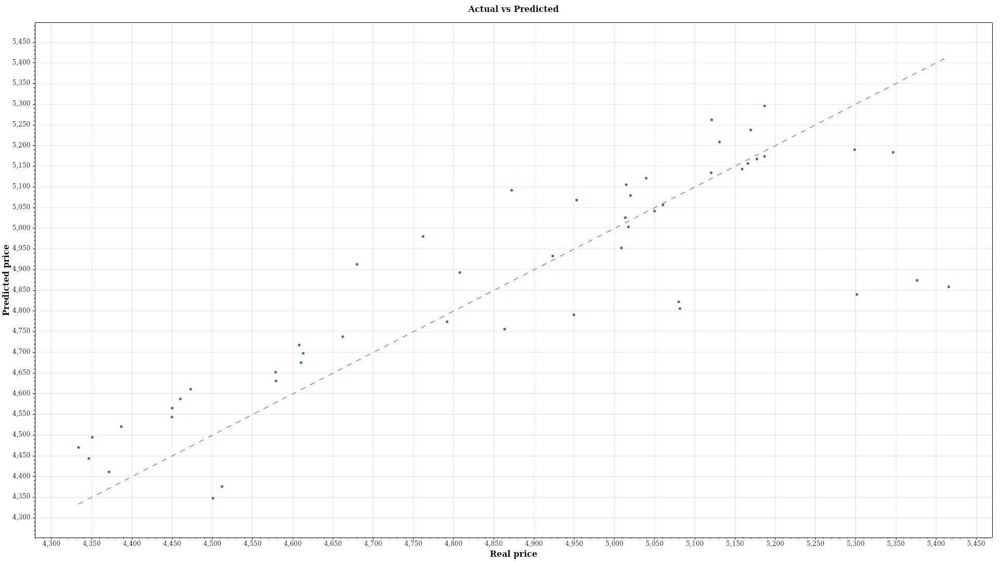

# Regresion


A console tool that fits a multiple linear regression model to a CSV file using the normal equation. Matrix multiplication, transposition and Gauss-Jordan inversion are implemented by hand. A small pandas script one-hot encodes categorical columns, then the C# core fits the last 50 rows. The coefficients, the MSE and a table of expected versus predicted values are printed in the terminal, and an Actual vs Predicted plot is saved as a PNG. The whole pipeline runs in Docker, so nothing has to be installed on the host.



## Technologies

- C# / .NET 10
- Python 3 / pandas
- CommandLineParser
- CsvHelper
- ScottPlot
- Spectre.Console
- xUnit
- Docker

## How to run

Docker is the only requirement.

1. Clone the repository and open the folder that contains the `Dockerfile`.

   ```bash
   git clone https://github.com/Zambrzyckii/regresion.git
   cd regresion/Regresion
   ```

2. Build the image.

   ```bash
   docker build -t regression-app .
   ```

3. Run it on the bundled gold futures dataset, predicting `close` from `ma_30` and `ma_90`.

   ```bash
   docker run -t --rm -v "$(pwd):/data" regression-app -p /data/gold_futures_timeseries.csv -x ma_30 ma_90 -y close
   ```

The plot is saved as `samples.png` in the current folder. To use your own file, put it in that folder and change the `-p` path. Use `-x` for one or more feature columns and `-y` for the target column.
